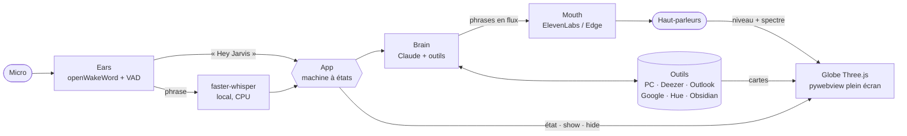

<div align="center">

# J · A · R · V · I · S

**Un majordome vocal pour Windows.** Vous dites « Hey Jarvis », un globe holographique s'allume plein écran, et vous lui parlez comme à quelqu'un.


*Maquette animée : ouvrez [docs/maquette.html](docs/maquette.html) dans un navigateur.*

</div>

---

## Ce qu'il fait

> **Vous :** Hey Jarvis.
> *Le globe implose en plein écran, petit carillon.*
> **Vous :** Quel temps demain, et comment ont fini les marchés ?
> **Jarvis :** Dix-neuf degrés et du soleil demain à Paris, Monsieur. Le CAC termine en hausse de 0,8 %, le Nasdaq recule légèrement.
> *Deux cartes holographiques apparaissent à droite du globe, puis s'effacent.*
> **Vous :** Ouvre Deezer et mets du Daft Punk.
> *Le globe s'efface, Deezer passe au premier plan, la musique démarre.*
> **Vous :** Réponds à Léa que je serai là samedi.
> **Jarvis :** Je réponds à Léa : « Je serai là samedi. » Je confirme, Monsieur ?
> **Vous :** Oui.
> **Vous :** Merci Jarvis.
> **Jarvis :** À votre service, Monsieur. *Il repasse en veille.*

| | |
|---|---|
| **Réveil** | « Hey Jarvis », détecté **localement** (openWakeWord). Rien ne quitte le PC avant. Raccourci `Ctrl+Alt+J` en secours. |
| **Conversation** | Libre après le réveil, sans répéter le mot-clé. Il se rendort après un silence ou « merci Jarvis ». |
| **Coupure** | Dites « Hey Jarvis » pendant qu'il parle : il se tait net et vous écoute. |
| **Cerveau** | Claude (Anthropic) avec 35 outils, plus la recherche web pour l'actualité. |
| **Voix** | ElevenLabs en flux continu : la première phrase part avant que la réponse soit finie. Voix Edge gratuite en secours. |
| **Oreilles** | faster-whisper en local, sur CPU. |
| **Interface** | Un globe de 11 000 particules en Three.js qui écoute (bleu vif), réfléchit (ambre) et parle au rythme de la voix. Il se cache dès qu'il vous envoie dans une appli. |

### Les outils

| Domaine | Ce qu'on peut lui demander |
|---|---|
| **PC** | ouvrir une appli, un site ou un fichier ; volume ; veille et extinction ; état du PC ; déplacer une fenêtre d'écran ; « regarde mon écran » |
| **Fichiers** | trouver n'importe quel fichier (Everything si installé), l'ouvrir, le lire et le résumer |
| **Musique** | Deezer à la voix : titre, artiste, album, playlist ; pause, suivant ; « c'est quoi ce morceau ? » |
| **Outlook.com** | lire, résumer, répondre, envoyer, chercher un contact |
| **Google** | Gmail (lire, envoyer, répondre), Agenda (consulter, créer), Drive (chercher, ouvrir) |
| **Maison** | lumières Philips Hue (pièce, intensité, couleur), prises et ampoules Tapo / Kasa |
| **Infos** | météo à l'endroit où vous êtes, marchés mondiaux, brief sur demande (IA → marchés → actu → finance) |
| **Mémoire** | retient ce que vous lui dites dans Obsidian (`Jarvis/`), lit tout le coffre |

## Règles non négociables

Ces règles sont **imposées par le code**, pas seulement demandées au modèle :

1. **Confirmation orale.** Toute action qui part chez quelqu'un d'autre ou qu'on ne peut pas défaire (envoyer ou répondre à un mail, créer un rendez-vous, mettre en veille ou éteindre le PC) passe par « Je confirme, Monsieur ? ». Un silence ou une réponse floue vaut **non**. Les gestes réversibles (lumière, volume, musique, ouvrir une appli) s'exécutent directement.
2. **Zéro suppression.** Aucun outil ne supprime quoi que ce soit : mails, fichiers, rendez-vous, notes.
3. **Zones interdites.** Dossiers système, profils de navigateur, `.ssh`, `.env` et coffres de mots de passe ne sont jamais lus.
4. **Secrets hors des fichiers.** Les clés vont dans le Gestionnaire d'identification Windows, les jetons OAuth sont chiffrés (DPAPI).

Le détail est dans [docs/SECURITY.md](docs/SECURITY.md).

## Architecture



```
jarvis/
├── app.py            machine à états : veille → conversation → veille, coupure, confirmation
├── brain.py          boucle Claude : flux, outils, phrases envoyées à la voix au fil de l'eau
├── persona.py        le majordome : ton, vouvoiement, règles
├── audio/
│   ├── ears.py       micro, mot-clé, fin de phrase, détection de coupure
│   ├── stt.py        transcription locale
│   └── voice.py      ElevenLabs / Edge → lecteur 24 kHz → spectre pour le globe
├── tools/            un fichier par domaine, chaque outil déclaré avec @tool(...)
├── ui/
│   ├── server.py     pont WebSocket Python ↔ page
│   ├── window.py     fenêtre sans bordure sur l'écran externe
│   └── web/          globe.js (Three.js), cards.js, style.css
└── cli.py            jarvis run | setup | auth | doctor | ask | say | preview
```

## Installation (Windows 10/11)

```powershell
git clone <ce dépôt> jarvis; cd jarvis
powershell -ExecutionPolicy Bypass -File scripts\install.ps1
.\.venv\Scripts\activate
jarvis setup            # clé Anthropic, clé ElevenLabs, voice_id, coffre Obsidian
jarvis doctor           # tout doit être ✔
jarvis run              # puis : « Hey Jarvis »
```

Les comptes se connectent un par un, chacun selon son guide dans [docs/SETUP.md](docs/SETUP.md) :

```powershell
jarvis auth outlook
jarvis auth google
jarvis auth hue
```

Démarrage automatique à l'ouverture de session : `scripts\autostart.ps1`.

### Commandes utiles

| Commande | Rôle |
|---|---|
| `jarvis preview` | le globe dans le navigateur, sans micro ni clé (touches `1`–`4`, `h`, `w m e a s i`) |
| `jarvis ask "quel temps fait-il ?"` | le cerveau et les outils au clavier ; `--chat` pour continuer |
| `jarvis say "Bonsoir, Monsieur."` | tester la voix |
| `jarvis devices` | lister micros et haut-parleurs (index pour `config.yaml`) |
| `/` dans la fenêtre | écrire à Jarvis au lieu de parler |

## Coûts

Budget visé : **5 à 15 € par mois**.

- **Anthropic** : paiement à l'usage. Avec Sonnet et `effort: low`, une conversation coûte quelques centimes. Fixez une limite mensuelle dans la console.
- **ElevenLabs** : l'abonnement d'entrée suffit pour un usage quotidien avec `eleven_flash_v2_5`. Au-delà du quota, Jarvis passe tout seul sur la voix Edge gratuite.
- **Le reste est gratuit** : transcription locale, Open-Meteo, Yahoo Finance, Deezer, et les API Microsoft et Google pour un usage personnel.

## Développement

```powershell
pip install -e ".[dev]"
pytest              # 70 tests : dialogue, confirmation, coupure, outils, audio, interface
```

Pour ajouter un outil, créez une fonction dans `jarvis/tools/<domaine>.py` avec `@tool(nom, description, schéma)`. Ajoutez `confirm=` si l'outil modifie quoi que ce soit, et `hides_ui=True` s'il emmène Monsieur ailleurs.

<div align="center">


<sub>Projet personnel, sans lien avec Marvel ni Disney. Licence MIT.</sub>

</div>
